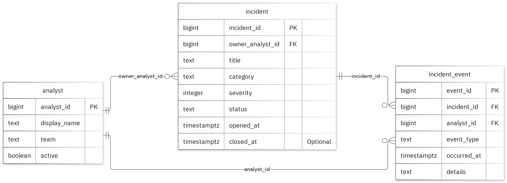

# MIT 8103 Advanced Database Systems

**SentinelNaija – Cybersecurity incident management** · Latifat Akinwale · Student ID 301923787

## Case study

My case study is SentinelNaija – Cybersecurity incident management. I designed the database for incident coordinators, response analysts and management reviewers, with separate tables named analyst, incident and incident_event. It supports these operations, register incidents and assign an analyst, record timestamped response events, review incident status and summarize response activity.

## Portfolio 1: Database Design and Modelling

I organised the relational design into 3 tables. Primary keys identify records, foreign keys preserve the links and checks enforce the stated business rules. Incident severity must be an integer from 1 through 5. The normalisation examples show the sample data at 1NF, 2NF and 3NF. All 10 deliberately invalid inserts were rejected without changing the valid sample rows.

Figure 1. Tables, keys and relationships. PK: primary key; FK: foreign key; UK: unique value.

<!-- PAGE BREAK -->

## Portfolio 2: Query Processing and Optimisation

I ran four SQL queries against the sample records. The join returned 1 rows and included Synthetic access alert with Amina Okafor. For the index comparison, I used 50,000 separate performance rows. The median lookup time changed from 2.369 ms to 0.251 ms. Both phases returned the same records. The measured plan used the new index. These timings apply to this lookup and environment.

## Portfolio 3: Transactions and Concurrency

I used a temporary counter on incident to test COMMIT, ROLLBACK and READ COMMITTED isolation. The uncommitted update remained hidden from the other sessiongit  and ROLLBACK restored the earlier committed value. Without locking, two increments left the counter at 2. With SELECT FOR UPDATE, Session B waited for Session A and the final value was 3. The helper is confined to this exercise; the case's original business fields stay unchanged.

## Portfolio 4: NoSQL and Advanced Data Models

I used incident_event_stream for the case's event documents. MongoDB inserted 2 sample events and returned the expected results for 4 queries. Validation rejected an invalid date type and a duplicate event ID. Embedded snapshots keep related details with an event, while the details field can differ by event type. These are fictional events; PostgreSQL continues to enforce its relational rules.

## Repository and evidence

https://github.com/Latifat-Akinwale/Akinwale_Latifat_301923787

The portfolio folders contain the SQL and JavaScript, explanations, query plans, result tables and screenshots.

<!-- PAGE BREAK -->

## Portfolio 5: Distributed and Cloud Database Exercise

I proposed three MongoDB replica members across separate failure zones. The discussion covers primary elections, majority acknowledgement, secondary lag and sharding trade-offs for incident_event_stream. Replication supports availability, while backups address recovery. PostgreSQL needs its own availability plan. This is the permitted discussion option; no live replica set or failover test was deployed.

## Individual reflection

This Project helped me understand how to apply the concepts from the database module (MIT 8103 Advanced Database Systems) to create a practical database for managing cyber security incidents. I chose to have 3 tables: Analyst, Incident and Incident_Event to keep the database clean and without any redundant data. Primary and foreign keys were used to link the tables together. Constraints were also used to prevent incorrect data being put into the database, for example, the Severity column for an Incident would only allow values between 1-5.
Understanding how to maintain data consistency was a challenge. The concurrency exercise really helped me understand how having two sessions updating a record would cause a problem. By using Select For Update I understood how locking helps prevent this issue. The indexing exercise was interesting to see how querying improved after an index had been created.
Using MongoDB helped improve my understanding of the differences between relational and NoSQL databases. I learnt that MongoDB provides more flexibility when storing event information with varied data. However validation is still important. The distributed database exercise helped me understand why replication, availability and backup are important.
Overall this project has shown me that to create a good database you need to make some good decisions about the design. Testing different scenarios will help to ensure the data is accurate. I did use GitHub Copilot to help create some of the scripts and queries however I checked the outcomes and tested them. This has increased my confidence in using database technologies and has shown me how they can be used to solve real problems.

## AI-use declaration

To assist with coding efficiency, I used GitHub Copilot to help construct the database schemas, scripts, execution of the PostgreSQL, MongoDB queries and baseline explanations. I have thoroughly reviewed the output results, image captures and I am totally accountability for the final explanations and submitted code.

## References

- [PostgreSQL: constraints](https://www.postgresql.org/docs/17/ddl-constraints.html)
- [PostgreSQL: EXPLAIN](https://www.postgresql.org/docs/17/using-explain.html)
- [PostgreSQL: isolation](https://www.postgresql.org/docs/17/transaction-iso.html)
- [PostgreSQL: row locks](https://www.postgresql.org/docs/17/explicit-locking.html)
- [MongoDB: data modelling](https://www.mongodb.com/docs/manual/data-modeling/)
- [MongoDB: replication](https://www.mongodb.com/docs/manual/replication/)
- [MongoDB: sharding](https://www.mongodb.com/docs/manual/sharding/)
- [Mermaid: ER diagrams](https://mermaid.js.org/syntax/entityRelationshipDiagram.html)

