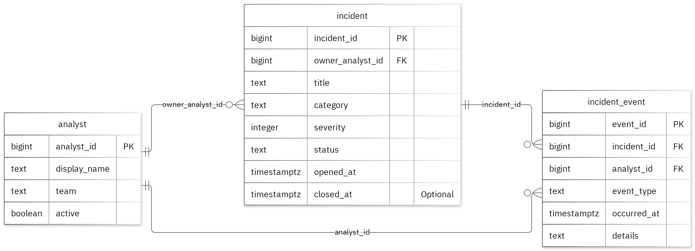

# SentinelNaija – Cybersecurity incident management

**MIT 8103 Advanced Database Systems** · Latifat Akinwale · Student ID 301923787

This repository holds my five-part database portfolio for SentinelNaija, a fictional cybersecurity incident management case study. All records in it are fictional sample data.

## Case study

SentinelNaija's incident coordinators, response analysts and management reviewers use the database to:

- register incidents and assign an owning analyst
- record timestamped response events
- review incident status
- summarise response activity

The relational model has three tables in the `portfolio` schema:

| Table | Purpose | Key rules |
| --- | --- | --- |
| `analyst` | Response analysts and their teams | Primary key `analyst_id` |
| `incident` | Reported incidents | Owner must be an existing analyst; severity is 1–5; status is `open`, `investigating`, `contained` or `closed`; `closed_at` must be after `opened_at` |
| `incident_event` | Timestamped actions taken on an incident | Must reference an existing incident and analyst |



## Technologies

- **PostgreSQL** for the relational schema, queries, indexing and transactions (Portfolios 1–3)
- **MongoDB** (`mongosh`) for the event document model (Portfolio 4)
- **Mermaid** for the ER diagram source

## Portfolio overview

| # | Topic | What it covers | Key result |
| --- | --- | --- | --- |
| 1 | [Database Design and Modelling](portfolio-1-database-design/) | Schema, keys, business-rule constraints, ER diagram, normalisation to 3NF | All 10 deliberately invalid inserts were rejected; valid rows unchanged |
| 2 | [Query Processing and Optimisation](portfolio-2-query-optimisation/) | Analytical SQL queries, `EXPLAIN (ANALYZE, BUFFERS)` before and after an index | Median lookup on 50,000 rows fell from 2.369 ms to 0.251 ms (Seq Scan → Bitmap Index Scan) |
| 3 | [Transactions and Concurrency](portfolio-3-transactions-concurrency/) | COMMIT, ROLLBACK, READ COMMITTED isolation, two-session lost update | Unlocked read-modify-write lost an update (2 instead of 3); `SELECT ... FOR UPDATE` gave the correct 3 |
| 4 | [NoSQL and Advanced Data Models](portfolio-4-nosql/) | MongoDB `incident_event_stream` collection with embedded snapshots, schema validation and indexes | 2 documents inserted; invalid date (code 121) and duplicate ID (code 11000) rejected |
| 5 | [Distributed and Cloud Database](portfolio-5-distributed-cloud/) | Proposed three-member MongoDB replica set across availability zones, consistency settings, sharding trade-offs, backup and security | Design discussion only; no live cluster was deployed |

Each folder has its own README with the full explanation, results and screenshots.

## Repository structure

```text
.
├── README.md
├── Akinwale_Latifat_301923787_FinalSummary.md   # Final summary (source)
├── Akinwale_Latifat_301923787_FinalSummary.pdf  # Final summary (submission PDF)
├── images/                                      # ER diagram used in the summary
├── portfolio-1-database-design/                 # Schema, sample data, constraint tests, design notes
├── portfolio-2-query-optimisation/              # Queries and index optimisation script
├── portfolio-3-transactions-concurrency/        # Transaction script and two-session scripts
├── portfolio-4-nosql/                           # MongoDB script
└── portfolio-5-distributed-cloud/               # Distributed design discussion and diagram
```

Every portfolio folder has a `screenshots/` subfolder with the evidence referenced in its README.

## Running the scripts

You need PostgreSQL with `psql` and MongoDB with `mongosh`. Use a fresh database for each run, because the schema script creates the `portfolio` schema and fails if it already exists.

1. **Portfolio 1:** run `P1_Schema.sql`, then `P1_SampleData.sql`. Run each statement in `P1_ConstraintTests.sql` on its own, outside a transaction. Each one is expected to fail.
2. **Portfolio 2:** on a database loaded with the Portfolio 1 schema and sample data, run `P2_Queries.sql`, then `P2_Optimisation.sql`. The optimisation script creates a separate performance table for the index comparison.
3. **Portfolio 3:** on a fresh Portfolio 1 database, run `P3_Transactions.sql`. Then open two `psql` sessions on the same database and follow steps 1–9 across `P3_SessionA.sql` and `P3_SessionB.sql`.
4. **Portfolio 4:** connect `mongosh` and run `P4_MongoDB.js`. It switches to the `portfolio_nosql` database, creates the collection, inserts the samples and prints the query results.
5. **Portfolio 5:** there is nothing to run. It is a written design proposal.

Timings in Portfolio 2 depend on the machine and environment.

## Final summary

The [final summary](Akinwale_Latifat_301923787_FinalSummary.md) ([PDF](Akinwale_Latifat_301923787_FinalSummary.pdf)) brings together the results of all five portfolios. It also contains my individual reflection, AI-use declaration and full reference list.

## References

- [PostgreSQL: constraints](https://www.postgresql.org/docs/17/ddl-constraints.html)
- [PostgreSQL: EXPLAIN](https://www.postgresql.org/docs/17/using-explain.html)
- [PostgreSQL: transaction isolation](https://www.postgresql.org/docs/17/transaction-iso.html)
- [PostgreSQL: explicit locking](https://www.postgresql.org/docs/17/explicit-locking.html)
- [MongoDB: data modelling](https://www.mongodb.com/docs/manual/data-modeling/)
- [MongoDB: replication](https://www.mongodb.com/docs/manual/replication/)
- [MongoDB: sharding](https://www.mongodb.com/docs/manual/sharding/)
